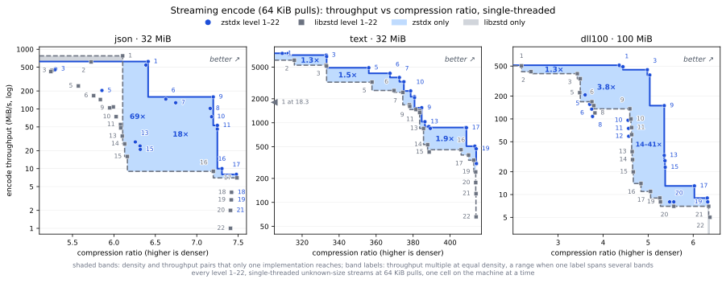
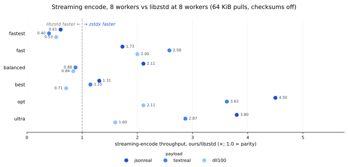
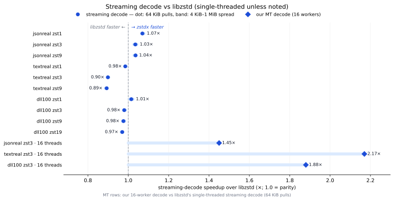

# Zstdx

Zstdx is a pure Rust implementation of the Zstandard compression format, built for performance. It started as a fork of [KillingSpark/zstd-rs](https://github.com/KillingSpark/zstd-rs) and rewrote the encoder from scratch. The decoder and the encoder cover the full format and interoperate with the reference C implementation in both directions.

- Decoder: complete. It handles dictionaries, multi-frame and skippable-frame streams, and verifies the checksum on every path.
- Encoder: the full numeric level ladder from 0 to 22, with fast, dfast, chain, btlazy2, btopt and btultra strategy families modeled on libzstd. It supports checksums, raw-content and `zstd --train` formatted dictionaries, long-distance matching, and multithreaded compression.
- Multithreaded decompression.
- `no_std` with `alloc`. The `zstdx::compat` layer mirrors the [`zstd` crate](https://docs.rs/zstd) API shape with numeric levels and `io::Result`, which makes porting straightforward.

Performance is tracked against libzstd in `docs/src/dev/` ([snapshot](https://github.com/lxl66566/zstdx/blob/main/docs/src/dev/bench/snapshot.md)).

## Usage

One-shot:

```rust
let data = b"the quick brown fox jumps over the lazy dog";
let compressed = zstdx::bulk::compress(data, zstdx::Level::Fastest);
let restored = zstdx::bulk::decompress(&compressed, 0).unwrap();
assert_eq!(&restored[..], data);
```

Streaming over `io::Read` and `io::Write`:

```rust
use zstdx::io::{Read, Write};

let mut compressed = Vec::new();
let mut enc = zstdx::stream::write::Encoder::new(&mut compressed, zstdx::Level::Fast).unwrap();
enc.write_all(b"some payload").unwrap();
enc.finish().unwrap();

let mut restored = Vec::new();
zstdx::stream::read::Decoder::new(&compressed[..])
    .unwrap()
    .read_to_end(&mut restored)
    .unwrap();
assert_eq!(restored, b"some payload");
```

Checksum, pledged size, worker threads, dictionaries and a forced window are set on the builder-style `zstdx::EncoderOptions` and `zstdx::DecoderOptions`. The [user guide](https://github.com/lxl66566/zstdx/blob/main/docs/src/user.md) walks through the full API. The reference documentation lives at `docs.rs/zstdx`.

## Feature flags

<!-- prettier-ignore -->
| Feature | Default | Effect |
|---|---|---|
| `std` | yes | `std::io` traits, threads, `compat` |
| `hash` | yes | XXH64 frame checksums, written and verified |
| `dict_builder` | no | dictionary training through `zstdx::dict` |

Without `std` the crate builds as `no_std` with `alloc`. Bulk, streaming and the low-level APIs still work, and thread options report `Error::Unsupported`.

## Performance

Benchmarks compare against the `zstd` crate (libzstd 1.6.0) on real-world payloads: an hour of GitHub Archive event JSON (`jsonreal`), 32 MiB of the Wikipedia XML dump (`textreal`), and a 100 MiB system-binary mix (`dll100`, [gen_big.sh](https://github.com/lxl66566/zstdx/blob/main/bench/gen_big.sh)). Each cell runs single-threaded with checksums off unless noted, and passes a roundtrip check. Run-to-run noise is ±10%. A speedup of 3.1x means zstdx finishes in about a third of the reference time. The figures cover the streaming paths, and the full tables including bulk and the synthetic regression corpus are in [snapshot.md](https://github.com/lxl66566/zstdx/blob/main/docs/src/dev/bench/snapshot.md) and [matrix.md](https://github.com/lxl66566/zstdx/blob/main/docs/src/dev/bench/matrix.md).



Each marker is one compression level from 1 to 22. The line under a side is the throughput of its fastest level at that density, the shading is colored by the side that leads there, and a band label gives the throughput gap at equal density.

On the real payloads zstdx emits the smaller frame at the majority of matched levels: 17 of 22 on jsonreal, 13 of 22 on the dll mix and 10 of 22 on Wikipedia XML. The deep tiers lead in density on jsonreal (level 9 runs 11% denser at the same speed, level 13 13% denser) and on the dll payload (levels 16 to 19 run 19% to 24% denser at up to 1.25x the speed), while the dll payload's fast levels emit 44% to 99% more compression than libzstd's at 1.0x to 1.2x the speed. Where a matched level is slower, it still emits the smaller frame or stays within 2% of the libzstd size. Across the synthetic regression sweep of 5 shapes, 6 levels, both APIs and both threading modes, the geometric mean ratio stays 8.7% denser than libzstd at matched levels.



With 8 workers on real payloads, streaming encode is 1.3x to 4.5x faster at the fast through ultra tiers on jsonreal, and 2.6x to 3.6x faster at fast, opt and ultra on Wikipedia XML. On the dll mix it is 2.0x faster at fast and 1.6x to 2.1x at opt and ultra, while the fastest tier trails libzstd's low-contention headline on every payload.



Streaming decode runs at 0.89x to 1.08x libzstd's speed on the real payloads, with jsonreal ahead at every level and pull size. The 16-worker decoder is 1.5x to 2.2x faster than libzstd's single-threaded decoder, and multi-frame inputs scale to up to 3.2x the single-threaded decoder.

## CLI

The companion `zstdx-cli` crate is a flag-compatible `zstd` command line. `zstdx file` writes `file.zst`, `-d` decodes, `-1` to `-19` and `--fast` select the level, `-T0` uses all cores, and `-D DICT` attaches a dictionary.

## Testing

Tests take two forms:

1. Tests on well-formed files must decode correctly and match their originals. Interop roundtrips against the reference implementation run through the dev-dependency on the `zstd` crate.
2. Tests on malformed input generated by the fuzzer. These inputs are garbage, so they may fail to decode. They must never panic the decoder.

## Fuzzing

The fuzz targets live in `crates/zstdx-fuzz`: `decode`, `decode_dict`, `encode`, `encode_stream`, `interop`, `fse` and `huff0`. From that directory, run `cargo +nightly fuzz run decode` or the same command with another target.

On a crash:

- The offending input is saved to the artifacts directory. `cargo test -p zstdx artifacts` reproduces it and shows where the decoder panics.
- Pull requests are welcome. An offending input is useful on its own when you cannot fix the crash.
